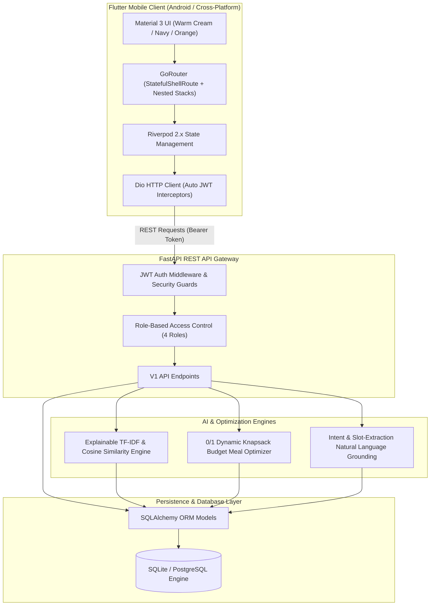
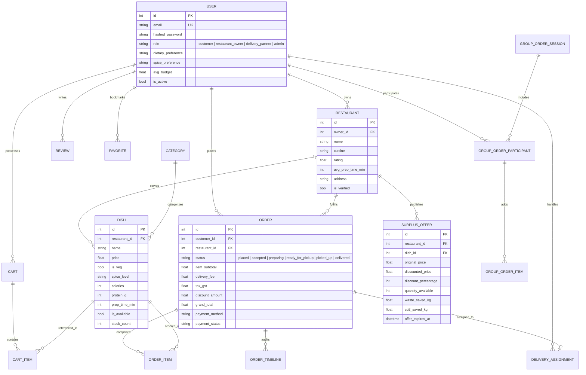
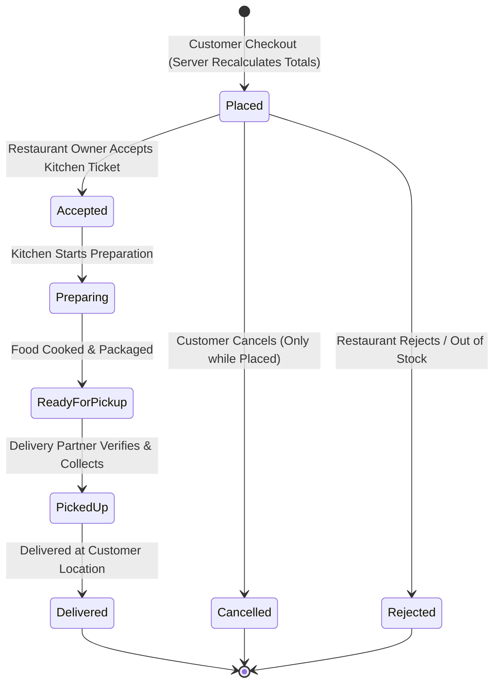

# FoodFusion AI — Architecture Specification & Engineering Design

This document details the software architecture, data models, AI recommendation pipelines, optimization algorithms, and security paradigms powering **FoodFusion AI — Smart Food Ordering & Sustainable Delivery**.

---

## 1. System Architecture Overview

FoodFusion AI is architected as an end-to-end decoupled system comprising a high-performance **Flutter** mobile client (Dart 3.x), a robust **FastAPI** backend (Python 3.14+), an **Explainable Scikit-Learn AI Engine**, a **Constraint-Based Knapsack Optimizer**, and a relational database (SQLite for local demo, with SQLAlchemy ORM abstraction enabling instant migration to PostgreSQL).

---

## 2. Entity-Relationship Data Model

The schema uses foreign key constraints, normalized structures, and status audit timelines.

---

## 3. Order Lifecycle & Status State Machine

Orders follow a strict linear progression with verification at each role boundary.

---

## 4. AI & Optimization Algorithms

### A. Explainable Hybrid Recommendation Engine
Located in `app/services/recommendation_service.py`.

1. **Content Representation**:
   Each dish document $D_i$ is synthesized as a feature text containing:
   $$\text{Text}(D_i) = \text{Cuisine} + \text{DishName} + \text{Ingredients} + \text{DietaryTag} + \text{SpiceLevel}$$
2. **TF-IDF Vectorization**:
   Computes word importance weights across the active menu corpus:
   $$\text{TF-IDF}(t, d, D) = \text{TF}(t, d) \times \log \left( \frac{1 + |D|}{1 + \text{DF}(t, D)} \right) + 1$$
3. **Scoring Function**:
   Given user profile vector $U$ and dietary filter constraints:
   $$\text{Score}(D_i, U) = 0.45 \cdot \text{CosineSimilarity}(\vec{D}_i, \vec{U}) + 0.25 \cdot \text{DietaryMatch} + 0.15 \cdot \text{SpiceMatch} + 0.15 \cdot \text{RatingNormalized}$$
4. **Transparent Explainability**:
   Instead of black-box outputs, each suggestion emits a human-readable badge:
   `"Recommended because you prefer spicy vegetarian food and this meal fits your ₹300 budget."`

---

### B. Smart 0/1 Knapsack Budget Meal Optimizer
Located in `app/services/budget_planner_service.py`.

- **Strict Constraint**: $\text{GrandTotal}(\text{Items}) = \sum \text{Price} + \text{GST}(5\%) + \text{EcoDeliveryFee}(₹35) \le \text{MaxBudget}$
- Guaranteed mathematical bound: If a user enters ₹150, the algorithm solves for the most satisfying combination (maximizing protein, calorie balance, and rating) whose combined cost including all taxes and fees does **not exceed ₹150**.
- If no combination exists, it provides exact reasons and the lowest feasible budget threshold.

---

### C. Conversational AI Natural Language Assistant
Located in `app/services/ai_assistant_service.py`.

- Extracts user intents: `high_protein`, `budget_bound`, `spice_filter`, `diet_filter`, `surplus_deals`, `similar_last_order`.
- Queries the live menu database without hallucinating non-existent restaurants or prices.
- Returns structured JSON cards containing live dish models that users can add directly to their cart in 1 tap.

---

### D. Sustainable Surplus Food Marketplace
Located in `app/services/surplus_service.py`.

- Restaurants list surplus inventory near closing or shift change at 40%–65% discount.
- Enforces real-time stock decrements with atomic database transactions.
- Calculates and displays environmental impact:
  $$\text{CO}_2\text{ Saved (kg)} = \text{WasteSaved (kg)} \times 2.5$$
- Offers expire automatically based on deadline timestamps, preventing unsafe food claims.

---

## 5. Security & Role-Based Access Control (RBAC)

| User Role | Accessible Endpoints | Permission Enforcement |
| :--- | :--- | :--- |
| **Customer** | `/cart/*`, `/orders/checkout`, `/recommendations`, `/budget-planner`, `/surplus`, `/group-orders/*`, `/ai-assistant/chat` | Checked via JWT bearer token |
| **Restaurant Owner** | `/restaurant/orders`, `/restaurant/orders/{id}/status`, `/restaurant/menu/*`, `/restaurant/surplus`, `/restaurant/analytics` | Blocked if role $\ne$ `restaurant_owner` |
| **Delivery Partner**| `/delivery/assignments`, `/delivery/assignments/{id}/accept`, `/delivery/assignments/{id}/status`, `/delivery/earnings` | Blocked if role $\ne$ `delivery_partner` |
| **Administrator** | `/admin/users`, `/admin/users/{id}/status`, `/admin/restaurants`, `/admin/restaurants/{id}/verify`, `/admin/analytics` | Blocked if role $\ne$ `admin` |

- Passwords hashed using standard **bcrypt**.
- Prices and billing totals are strictly calculated and validated on the backend. Client-submitted prices are discarded.
